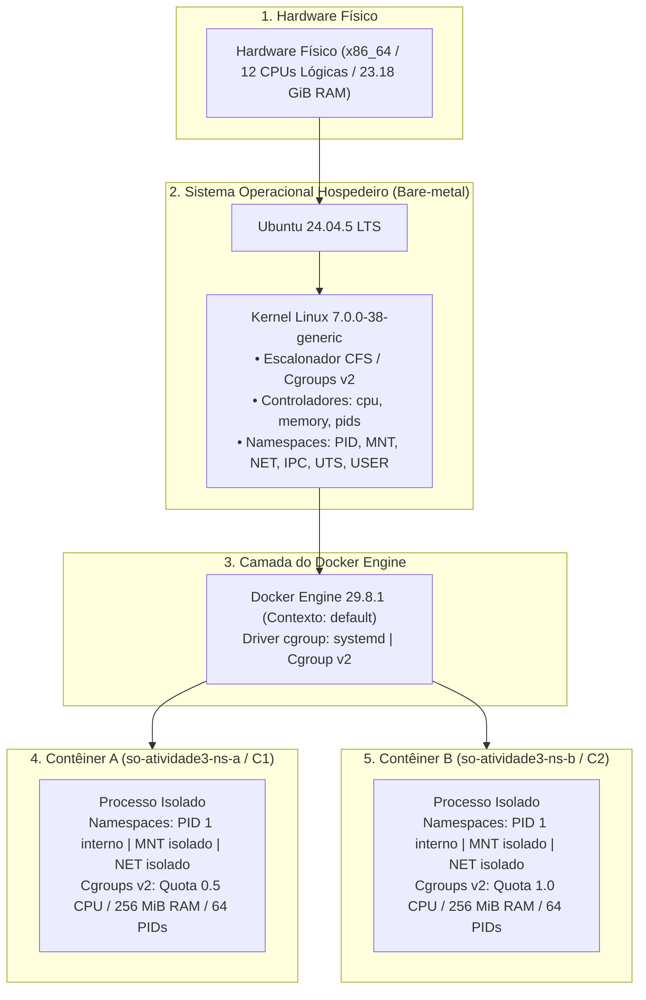

# Arquitetura de Execução e Isolamento

Este documento descreve as camadas de abstração, virtualização baseada em contêineres e isolamento de recursos utilizadas nos experimentos da **Atividade 3 de Sistemas Operacionais**.

## Diagrama da Arquitetura em Camadas

## Análise de Compartilhamento do Kernel

- **Ausência de Máquina Virtual Intermediária:** O ambiente operacional detectado é uma instalação nativa em *bare-metal* Linux. O kernel local (`7.0.0-38-generic`) é exatamente o mesmo executado pelo daemon do Docker (`7.0.0-38-generic`). Não há hipervisor (como QEMU, KVM, VirtualBox ou Hyper-V) intercalado entre o host e os contêineres.
- **Mecanismo de Contêineres:** Os contêineres não emulam hardware nem inicializam um novo kernel. Eles consistem puramente em processos convencionais do Linux encapsulados por duas tecnologias nativas do kernel:
  1. **Namespaces:** Criam visões virtuais e restritas de recursos globais (tabela de processos, árvores de montagem de sistemas de arquivos e interfaces de rede).
  2. **Cgroups v2 (Control Groups):** Monitoram, restringem e contabilizam a alocação de recursos físicos (tempo de CPU, limite de memória residente, swap e quantidade máxima de threads/tarefas).
- **Fixação da Imagem:**
  - Imagem base: `python:3.12-slim`
  - Digest criptográfico SHA256: `python@sha256:5e2bdb1b0d542d5039cffb8181c65930093949194a65c365dfb1b0fe13a4fa5b`
  - Imagem customizada: `so-atividade3:latest` (`sha256:d3ed221c9b03`)
