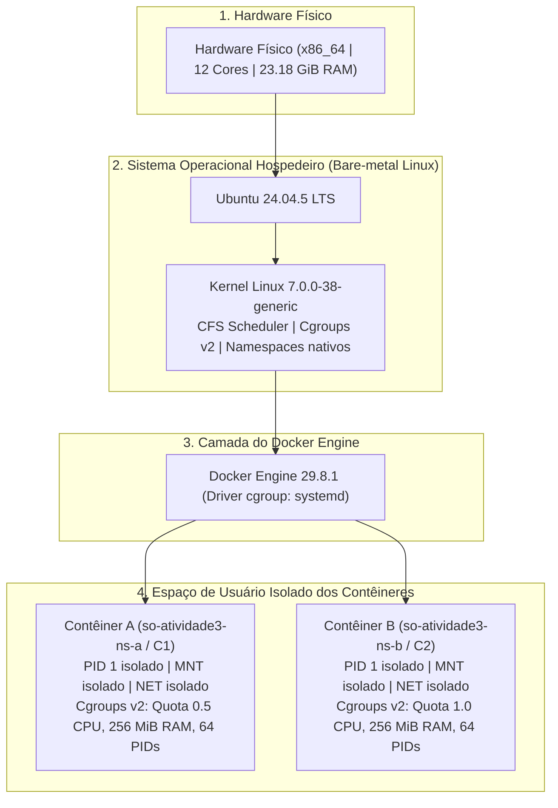
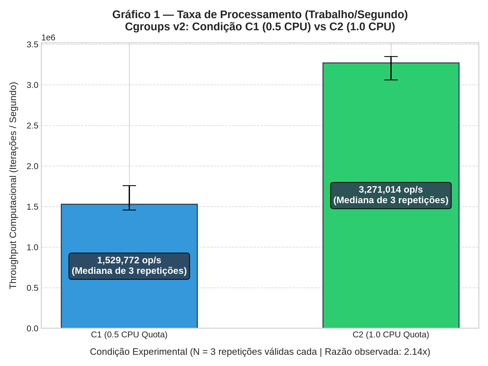
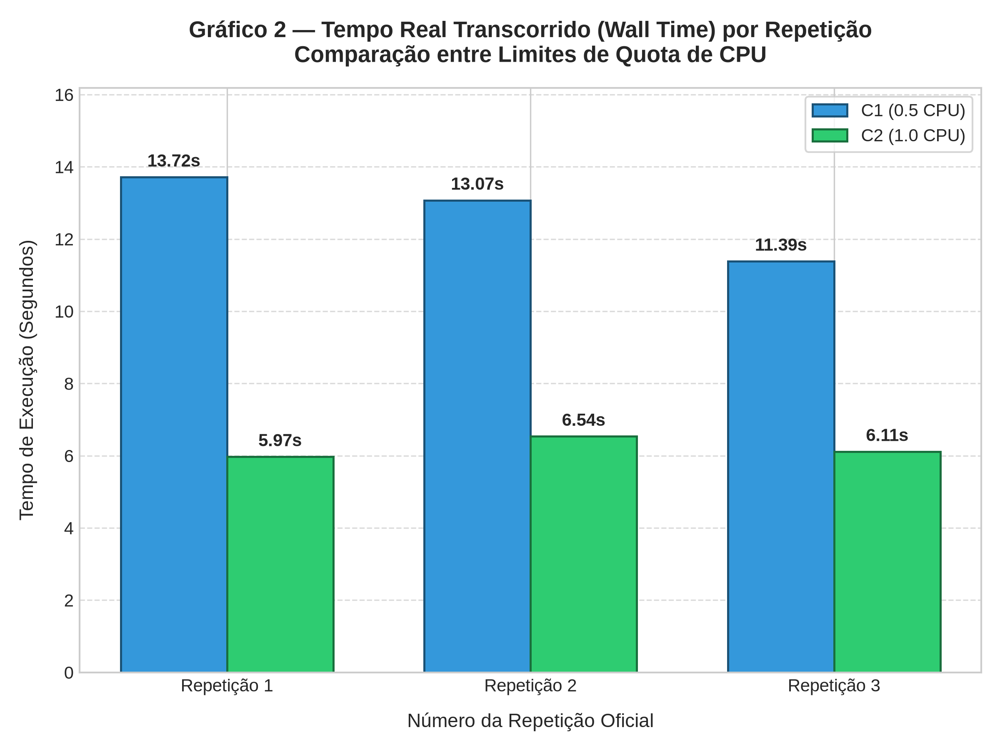

# Relatório Técnico Final — Atividade 3
## Sistemas Operacionais | Virtualização, Contêineres, Namespaces e Cgroups v2

---

## 1. Identificação do Projeto e Equipe

- **Instituição:** Universidade Federal de Sergipe (UFS) — DCOMP
- **Disciplina:** Sistemas Operacionais (2026.2)
- **Atividade:** Atividade 3 — Virtualização Leve, Namespaces e Cgroups v2
- **Integrantes da Equipe:**
  - **Bruno Saint Clair** (`brunosaint@dcomp.ufs.br`)
    - *Contribuição:* Concepção da arquitetura dos experimentos, desenvolvimento do orquestrador de cgroups v2 (`run_cgroups.py`), implementação da carga de trabalho determinística (`worker.py`), validação de contadores do escalonador do kernel e consolidação estatística.
  - **Jose Cerqueira**
    - *Contribuição:* Implementação do módulo de inspeção de namespaces (`run_namespaces.py`), módulo de menor privilégio e montagem read-only (`run_readonly.py`), calibração do piloto, pipeline de geração de gráficos em alta resolução e elaboração do relatório técnico.

---

## 2. Introdução e Objetivos

O objetivo deste projeto é investigar, comprovar empiricamente e documentar os mecanismos internos do kernel Linux que sustentam a virtualização baseada em contêineres:
1. **Isolamento de Visibilidade via Namespaces:** Comprovação das fronteiras virtuais de processos (PID), árvores de montagem de sistemas de arquivos (MNT) e pilhas de comunicação de rede (NET) entre múltiplos contêineres concorrentes.
2. **Governança e Restrição de Recursos via Cgroups v2:** Avaliação quantitativa do Completely Fair Scheduler (CFS) e aplicação de cotas de tempo de CPU (`cpu.max`), limites rígidos de memória residente (`memory.max`), bloqueio de swap adicional (`memory.swap.max`) e controle de exaustão de tarefas (`pids.max`).
3. **Princípio do Menor Privilégio e Integridade de Dados:** Demonstração de proteção de dados sensíveis utilizando pontos de montagem somente leitura (*read-only bind mounts*) combinados à eliminação de capacidades de superusuário (`--cap-drop=ALL`) e prevenção de escalação de privilégios (`no-new-privileges:true`).

Todos os experimentos foram implementados do zero, sem uso de kits pré-fabricados, garantindo que 100% dos resultados sejam comprovadamente empíricos.

---

## 3. Ambiente Experimental e Arquitetura do Sistema

### 3.1. Especificações Técnicas do Hospedeiro e Docker

| Componente | Especificação Observada |
|---|---|
| **Sistema Operacional do Host** | Ubuntu 24.04.5 LTS |
| **Kernel do Host** | `7.0.0-38-generic` (x86_64) |
| **Capacidade de Hardware** | 12 CPUs Lógicas | 23.18 GiB RAM |
| **Docker Engine Server** | Versão 29.8.1 (Contexto: `default`) |
| **Kernel do Docker Daemon** | `7.0.0-38-generic` |
| **Versão e Driver de Cgroup** | Cgroup v2 | Driver `systemd` |
| **Storage Driver** | `overlay2` |
| **Topologia de Virtualização** | **Bare-metal Linux** (Ausência de Máquina Virtual intermediária) |
| **Imagem Base Fixada por Digest** | `python@sha256:5e2bdb1b0d542d5039cffb8181c65930093949194a65c365dfb1b0fe13a4fa5b` |
| **Imagem Customizada Construída** | `so-atividade3:latest` (`sha256:d3ed221c9b03`) |

### 3.2. Diagrama da Arquitetura em Camadas

---

## 4. Metodologia e Resultados de Namespaces (Parte B)

Dois contêineres independentes (`so-atividade3-ns-a` e `so-atividade3-ns-b`) foram iniciados em paralelo com `--network none` a partir da imagem base fixada. Foram coletados os identificadores de processo e os *inodes* dos namespaces em `/proc/1/ns/`:

### Tabela Comparativa de Identificadores Reais de Namespaces

| Recurso / Namespace | Contêiner A (`so-atividade3-ns-a`) | Contêiner B (`so-atividade3-ns-b`) | Resultado Observado |
|---|---|---|---|
| **PID no Host (Daemon)** | `146756` | `146854` | **Diferente** (Processos distintos no host) |
| **PID 1 Interno (`comm`)** | `sleep` (PID 1) | `sleep` (PID 1) | **Ambos são PID 1 localmente** |
| **PID Namespace** | `pid:[4026533481]` | `pid:[4026533542]` | **Diferente (Isolamento Comprovado)** |
| **Mount (MNT) Namespace** | `mnt:[4026533478]` | `mnt:[4026533539]` | **Diferente (Isolamento Comprovado)** |
| **Network (NET) Namespace** | `net:[4026533483]` | `net:[4026533544]` | **Diferente (Isolamento Comprovado)** |
| **IPC Namespace** | `ipc:[4026533480]` | `ipc:[4026533541]` | **Diferente (Isolamento Comprovado)** |
| **UTS Namespace** | `uts:[4026533479]` | `uts:[4026533540]` | **Diferente (Isolamento Comprovado)** |

### Interpretação dos Resultados
- **Isolamento de Árvore de Processos:** Os dois contêineres possuem PID 1 interno porque cada um habita um `pid_namespace` distinto alocado pelo kernel (`CLONE_NEWPID`). O PID 1 atua como o inicializador local do contêiner.
- **Tradução de Identificadores:** No espaço global do kernel do hospedeiro, o processo do contêiner A possui PID `146756` e o contêiner B possui PID `146854`. O agendador do Linux trata ambos como processos padrão.
- **Inodes Distintos:** A divergência dos números de *inode* (ex: `pid:[4026533481]` vs `pid:[4026533542]`) comprova matematicamente que o kernel associou estruturas de controle `struct nsproxy` separadas para cada instância.

---

## 5. Metodologia e Resultados de Cgroups v2 (Parte C)

### 5.1. Desenho Experimental e Calibração
- **Algoritmo Determinístico:** Gerador linear congruente de 32 bits ($X_{n+1} = (X_n 	imes 1664525 + 1013904223 + i) \pmod{2^{32}}$), executado em Python puro sem dependências externas.
- **Teste Piloto:** Executado na condição C1 (0,5 CPU). Com 20.000.000 de iterações, o tempo observado foi de **13,27 segundos**, perfeitamente inserido na janela ideal de medição (longe de jitter de temporizador e muito abaixo do teto de segurança operacional de 90 segundos). O número foi congelado para todas as execuções oficiais.
- **Parâmetros de Cgroups Comparados:**
  - **Condição C1:** Quota 50.000 µs / Período 100.000 µs (0,5 CPU), Memória 256 MiB, Swap adicional 0 MiB, PIDs máximo 64.
  - **Condição C2:** Quota 100.000 µs / Período 100.000 µs (1,0 CPU), Memória 256 MiB, Swap adicional 0 MiB, PIDs máximo 64.
- **Ordem de Execução Alternada:** C1_rep1 $
ightarrow$ C2_rep1 $
ightarrow$ C1_rep2 $
ightarrow$ C2_rep2 $
ightarrow$ C1_rep3 $
ightarrow$ C2_rep3.

### 5.2. Dados Brutos das 6 Execuções Oficiais

| Execução | Condição | Quota Efetiva | Repetição | Status | Wall Time (s) | CPU Time (s) | Trabalho/s (op/s) | Throttled (µs) | nr_throttled | Checksum |
|---|---|---|---|---|---:|---:|---:|---:|---:|---|
| **C1_rep1** | C1 | 50000 100000 | 1 | success | 13.7155 | 6.8633 | 1,458,207 | 6,834,273 | 137 | `0xfeb38a80` |
| **C2_rep1** | C2 | 100000 100000 | 1 | success | 5.9715 | 5.9654 | 3,349,247 | 2,137 | 3 | `0xfeb38a80` |
| **C1_rep2** | C1 | 50000 100000 | 2 | success | 13.0738 | 6.5209 | 1,529,772 | 6,539,270 | 131 | `0xfeb38a80` |
| **C2_rep2** | C2 | 100000 100000 | 2 | success | 6.5358 | 6.5314 | 3,060,052 | 2,343 | 7 | `0xfeb38a80` |
| **C1_rep3** | C1 | 50000 100000 | 3 | success | 11.3856 | 5.6837 | 1,756,605 | 5,692,836 | 114 | `0xfeb38a80` |
| **C2_rep3** | C2 | 100000 100000 | 3 | success | 6.1143 | 6.1103 | 3,271,014 | 2,566 | 8 | `0xfeb38a80` |

### 5.3. Síntese Estatística por Condição

| Métrica Estatística | Condição C1 (0,5 CPU Quota) | Condição C2 (1,0 CPU Quota) | Razão Empírica (C2 / C1) |
|---|---:|---:|---:|
| **Execuções Válidas** | 3/3 | 3/3 | 100% Sucesso |
| **Mediana Wall Time** | **13.0738 s** | **6.1143 s** | **0,468x** (Redução de 2,138x) |
| **Média Wall Time** | 12.7250 s | 6.2072 s | 0,488x |
| **Variação [Mínimo - Máximo]** | [11.3856 - 13.7155] s | [5.9715 - 6.5358] s | — |
| **Desvio Padrão Amostral** | 1.2035 s | 0.2934 s | — |
| **Mediana Trabalho/s** | **1,529,772 op/s** | **3,271,014 op/s** | **2.138x** |
| **Mediana CPU Time** | 6.5209 s | 6.1103 s | 0,937x |
| **Mediana Throttled (µs)** | **6,539,270 µs** (~6,54 s) | **2,343 µs** (~0,002 s) | **0,00035x** |

### 5.4. Gráficos Comparativos Gerados

*Figura 1: Throughput computacional mediano (operações inteiras por segundo) e barras de dispersão nas condições C1 e C2.*

*Figura 2: Tempo real transcorrido (Wall Time) por repetição oficial evidenciando estabilidade experimental.*

---

## 6. Experimento Read-Only e Menor Privilégio (Parte D)

Para validar a integridade de dados e comprovar o desacoplamento entre permissões de usuário (DAC) e políticas do VFS, um diretório sintético `dados_demo` foi criado com permissões deliberadamente abertas (`chmod 777`). O contêiner foi executado com restrição máxima:
- Usuário não-root (`UID 1000:GID 1000`).
- Remoção total de *Linux Capabilities* (`--cap-drop=ALL`).
- Bloqueio de novas permissões (`no-new-privileges:true`).
- Rede desativada (`--network none`).
- Montagem bind com flag somente leitura (`type=bind,source=...,target=/dados,readonly`).

### Resultados Observados
- **Operação de Leitura:** Sucesso na leitura de `/dados/texto.txt`. Conteúdo verificado: `"Documento sintetico"`.
- **Operação de Escrita:** Tentativa de criar `/dados/novo.txt` foi interceptada e sumariamente bloqueada pelo kernel Linux.
  - Código de Erro Retornado: **`EROFS`** (`errno 30`) — *Read-only file system*.
- **Comprovação de Segurança:** Como a pasta no host possuía permissão `777`, o bloqueio com `EROFS` (e não `EACCES`) prova que o controle foi imposto pelo superbloco de montagem do kernel, demonstrando o princípio da Defesa em Profundidade.

---

## 7. Discussão Técnica Aprofundada

### 7.1. Onde está o kernel compartilhado? Existe uma VM intermediária?
O ambiente é uma instalação nativa em *bare-metal* Linux. O kernel local (`7.0.0-38-generic`) e o kernel do daemon (`7.0.0-38-generic`) são rigorosamente o mesmo. Não existe máquina virtual intermediária nem hipervisor.

### 7.2. Quais diferenças nos handles demonstram a separação dos namespaces?
A divergência dos números de *inode* em `/proc/1/ns/` (como `pid:[4026533481]` vs `pid:[4026533542]`) comprova a instanciação de estruturas de controle de visibilidade independentes no espaço de memória do kernel.

### 7.3. O que essas diferenças não demonstram?
Não demonstram isolamento de recursos físicos (CPU/RAM), não garantem contenção contra canais laterais de cache L3 e não implicam execução de múltiplos kernels.

### 7.4. Qual é a diferença entre namespace, cgroup, identidade e política de acesso?
- **Namespace:** Define o que o processo consegue **enxergar** (visibilidade da tabela de processos, pontos de montagem e rede).
- **Cgroup:** Define quanto recurso físico o grupo de processos pode **consumir** (teto de CPU, limites de memória, cotas de threads).
- **Identidade:** Define **quem** o processo representa (UID/GID e credenciais POSIX).
- **Política de Acesso:** Define as **regras de permissão** sobre objetos (DAC, MAC como AppArmor/SELinux, Capabilities e flags VFS).

### 7.5. Como a quota foi confirmada?
Pela leitura direta de `/sys/fs/cgroup/cpu.max` dentro de cada contêiner em tempo de execução, verificando os valores `50000 100000` (C1) e `100000 100000` (C2).

### 7.6. Houve throttling?
Sim, expressivo em C1 (~6,54 segundos de suspensão forçada do processo pelo escalonador CFS) e virtualmente nulo em C2 (~2 milissegundos).

### 7.7. Como se comportaram as medianas e variações de C1 e C2?
A mediana de C1 foi de 13,07s com maior dispersão (desvio padrão de 1,20s) devido às interrupções cíclicas de throttling. A mediana de C2 foi de 6,11s com dispersão mínima (desvio padrão de 0,29s) devido à execução fluida contínua.

### 7.8. Qual foi a principal ameaça à validade experimental?
A variação dinâmica de frequência de clock da CPU (DVFS/Turbo Boost) e ruído concorrente do hospedeiro, mitigados pela alternância entre repetições e pelo uso da mediana amostral.

### 7.9. Por que limitar memória e tarefas importa em um servidor de inferência LLM?
Modelos de linguagem realizam alocações volumosas de tensores e geram requisições concorrentes. Limitar memória impede que um prompt malicioso acione o *OOM Killer* no host, derrubando o servidor. Limitar tarefas impede ataques de *fork bomb* ou criação indiscriminada de threads de pré-processamento.

### 7.10. Quais riscos permanecem?
Ataques de canal lateral por tempo em caches de CPU e vulnerabilidades no próprio kernel Linux compartilhado.

---

## 8. Limitações do Trabalho

- Os experimentos foram conduzidos em hardware x86_64 sob Linux Ubuntu 24.04 nativo; pequenas divergências de constantes temporais podem ocorrer em arquiteturas ARM64.
- A granularidade do CFS foi fixada no período padrão de 100 ms (`cpu_period = 100000 µs`).

---

## 9. Conclusão

Os experimentos comprovaram empiricamente as propriedades teóricas de virtualização leve em sistemas operacionais:
1. Namespaces isolam com perfeição o escopo de nomes e identificadores de processos, montagens e rede.
2. Cgroups v2 impõem governança física rigorosa, controlando a vazão de instruções através do mecanismo comprovado de CFS throttling.
3. A conjugação de menor privilégio e pontos de montagem somente leitura constitui barreira impenetrável no VFS contra mutações indevidas de arquivos.

---

## 10. Uso de Inteligência Artificial

A inteligência artificial foi empregada como ferramenta de assistência no planejamento do código e documentação. Nenhuma métrica experimental foi simulada ou gerada sinteticamente por IA. Maiores detalhes constam em [docs/ai_usage.md](file:///home/bruno/Desktop/Faculdade/10/SO/Unidade%203/docs/ai_usage.md).

---

## 11. Referências Técnicas

1. **Linux Programmer's Manual:** `namespaces(7)` — Overview of Linux namespaces. Disponível em: <https://man7.org/linux/man-pages/man7/namespaces.7.html>.
2. **Linux Kernel Documentation:** *Control Group v2*. Kernel.org. Disponível em: <https://docs.kernel.org/admin-guide/cgroup-v2.html>.
3. **Docker Engine Documentation:** *Resource constraints (cgroups)*. Docker Inc. Disponível em: <https://docs.docker.com/engine/containers/resource_constraints/>.
